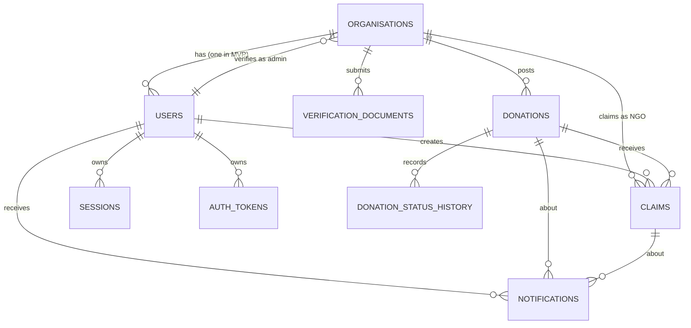

# Database Design — Food Donation Coordination System

**Status:** MVP schema agreed 2026-11-17.

## 1. Conventions

- **Database:** PostgreSQL 15+, accessed through Prisma as scaffolded. Database names use `snake_case`; Prisma models may map to them explicitly.
- **Primary keys:** UUID (`gen_random_uuid()`), never sequential ids exposed to clients.
- **Time:** all timestamps are `timestamptz`, stored and compared in UTC. The UI converts to the single supported city's local time.
- **Enums:** enforced with PostgreSQL enums; application code imports generated types rather than string constants.
- **Deletes:** no hard deletes for organisations, users, donations, claims, documents or history. Auth artefacts (sessions, expired tokens) and old notifications may be cleaned up by retention jobs. Core foreign keys use `ON DELETE RESTRICT`.
- **Audit:** every donation status change appends a row to `donation_status_history` in the same transaction. Verification decisions and claim cancellations record actor and reason.
- **Files:** binaries are never stored in the database. Only private/random storage keys and metadata are stored; document files live outside the public web root.
- **Email:** stored lowercase by the application; no `citext` extension is required.
- **Partial indexes and `CHECK` constraints:** expressed in raw SQL migrations because Prisma's schema language cannot declare them directly. They are still part of this design and must not be dropped.

## 2. ERD

Cardinalities:

- An organisation has exactly one user login in the MVP; admins have no organisation.
- A donor organisation has many donations; an NGO organisation has many claims.
- A donation has many historical claims but at most one active claim.
- A donation has many status-history rows; none are updated or deleted.
- Users receive many notifications and own many sessions and auth tokens.

## 3. Enums

| Enum | Values | Used by |
| --- | --- | --- |
| `user_role` | `donor`, `ngo`, `admin` | `users.role` |
| `org_type` | `donor`, `ngo` | `organisations.type` |
| `org_verification_status` | `pending`, `verified`, `rejected` | `organisations.verification_status` |
| `document_type` | `business_registration`, `food_safety_licence`, `ngo_registration`, `institution_authorisation`, `other` | `verification_documents.document_type` |
| `document_status` | `pending`, `approved`, `rejected` | `verification_documents.status` |
| `quantity_unit` | `kg`, `portions`, `meals`, `packets` | `donations.unit` |
| `donation_status` | `available`, `claimed`, `picked_up`, `completed`, `expired`, `cancelled` | `donations.status` |
| `claim_status` | `active`, `cancelled`, `completed` | `claims.status` |
| `notification_type` | `organisation_verified`, `organisation_rejected`, `donation_claimed`, `claim_released`, `donation_cancelled`, `pickup_confirmed`, `donation_completed`, `donation_expired` | `notifications.type` |
| `auth_token_type` | `email_verification`, `password_reset` | `auth_tokens.type` |

Required-document checklists are application rules, not enum values: donors normally supply business/institution authorisation plus a food-safety licence; NGOs supply NGO registration plus a food-safety licence. The `other` type allows the admin to accept an equivalent document.

## 4. Tables

### 4.1 `organisations`

| Column | Type | Constraints / notes |
| --- | --- | --- |
| `id` | `uuid` | PK, default `gen_random_uuid()` |
| `type` | `org_type` | NOT NULL |
| `name` | `varchar(160)` | NOT NULL; display name |
| `registration_number` | `varchar(80)` | NULL; official registration, if any |
| `contact_name` | `varchar(120)` | NOT NULL |
| `contact_phone` | `varchar(32)` | NOT NULL; normalised by the app |
| `contact_email` | `varchar(254)` | NOT NULL; lowercase |
| `address_line1` | `varchar(200)` | NOT NULL |
| `address_line2` | `varchar(200)` | NULL |
| `area` | `varchar(120)` | NOT NULL; used for public masking |
| `city` | `varchar(120)` | NOT NULL; used for filters |
| `postcode` | `varchar(16)` | NULL |
| `verification_status` | `org_verification_status` | NOT NULL, default `pending` |
| `verification_submitted_at` | `timestamptz` | NULL; set on submit/resubmit |
| `verified_at` | `timestamptz` | NULL |
| `verified_by_user_id` | `uuid` | NULL, FK `users(id)` RESTRICT; admin |
| `rejection_reason` | `text` | NULL; required when rejected |
| `created_at` | `timestamptz` | NOT NULL, default `now()` |
| `updated_at` | `timestamptz` | NOT NULL, default `now()`; app-maintained |

Constraints and indexes:

- `UNIQUE (type, registration_number)` where `registration_number IS NOT NULL`.
- Index `(verification_status, verification_submitted_at)` for the admin queue.
- Index `(type, city)` for organisation filters.
- `CHECK`: `verification_status = 'verified'` requires `verified_at` and `verified_by_user_id`; `'rejected'` requires `rejection_reason`; `'pending'` requires both verification fields to be null.
- The two FK paths between `organisations` and `users` must be named explicitly in Prisma to avoid ambiguity.

### 4.2 `users`

| Column | Type | Constraints / notes |
| --- | --- | --- |
| `id` | `uuid` | PK, default `gen_random_uuid()` |
| `organisation_id` | `uuid` | NULL, FK `organisations(id)` RESTRICT; null only for admins |
| `role` | `user_role` | NOT NULL |
| `email` | `varchar(254)` | NOT NULL, UNIQUE; stored lowercase |
| `password_hash` | `text` | NOT NULL |
| `email_verified_at` | `timestamptz` | NULL |
| `is_active` | `boolean` | NOT NULL, default `true` |
| `last_login_at` | `timestamptz` | NULL |
| `created_at` | `timestamptz` | NOT NULL, default `now()` |
| `updated_at` | `timestamptz` | NOT NULL, default `now()` |

Constraints and indexes:

- `UNIQUE (organisation_id)`: exactly one login per organisation. PostgreSQL treats nulls as distinct, so multiple admins are allowed.
- `CHECK`: admins have `organisation_id IS NULL`; donors and NGOs have a non-null organisation.
- Application rule: `users.role` must match `organisations.type` (`donor` user ↔ donor org, `ngo` user ↔ NGO org). This is cross-table and enforced in the service layer.
- Email is normalised to lowercase by the application before insert and lookup.

### 4.3 `verification_documents`

| Column | Type | Constraints / notes |
| --- | --- | --- |
| `id` | `uuid` | PK, default `gen_random_uuid()` |
| `organisation_id` | `uuid` | NOT NULL, FK `organisations(id)` RESTRICT |
| `uploaded_by_user_id` | `uuid` | NOT NULL, FK `users(id)` RESTRICT |
| `document_type` | `document_type` | NOT NULL |
| `status` | `document_status` | NOT NULL, default `pending` |
| `is_current` | `boolean` | NOT NULL, default `true` |
| `storage_key` | `text` | NOT NULL, UNIQUE; random, never a public URL |
| `original_filename` | `varchar(255)` | NOT NULL |
| `mime_type` | `varchar(100)` | NOT NULL; PDF/JPEG/PNG in the MVP |
| `size_bytes` | `integer` | NOT NULL; `CHECK (size_bytes > 0)`; app limit enforced too |
| `review_note` | `text` | NULL; required for rejection |
| `reviewed_by_user_id` | `uuid` | NULL, FK `users(id)` RESTRICT |
| `reviewed_at` | `timestamptz` | NULL |
| `uploaded_at` | `timestamptz` | NOT NULL, default `now()` |

Constraints and indexes:

- `UNIQUE (organisation_id, document_type) WHERE is_current`: one current document per type; replacements set the old row `is_current = false` and insert a new current row.
- Index `(organisation_id, uploaded_at DESC)` for document history.
- Index `(status, uploaded_at)` for the review queue.
- `CHECK`: approved/rejected rows require `reviewed_by_user_id` and `reviewed_at`; rejected rows also require `review_note`; pending rows have no reviewer fields.
- Reviewed documents are immutable; a replacement is a new row.

### 4.4 `donations`

| Column | Type | Constraints / notes |
| --- | --- | --- |
| `id` | `uuid` | PK, default `gen_random_uuid()` |
| `donor_organisation_id` | `uuid` | NOT NULL, FK `organisations(id)` RESTRICT |
| `title` | `varchar(140)` | NOT NULL |
| `description` | `text` | NOT NULL |
| `is_vegetarian` | `boolean` | NOT NULL |
| `quantity` | `numeric(10,2)` | NOT NULL; `CHECK (quantity > 0)` |
| `unit` | `quantity_unit` | NOT NULL |
| `best_before` | `timestamptz` | NOT NULL |
| `pickup_window_start` | `timestamptz` | NOT NULL |
| `pickup_window_end` | `timestamptz` | NOT NULL |
| `pickup_address_line1` | `varchar(200)` | NOT NULL; never exposed publicly |
| `pickup_address_line2` | `varchar(200)` | NULL |
| `pickup_area` | `varchar(120)` | NOT NULL; public |
| `pickup_city` | `varchar(120)` | NOT NULL; public |
| `pickup_postcode` | `varchar(16)` | NULL; never exposed publicly |
| `pickup_instructions` | `text` | NULL; revealed to claimant only |
| `allergen_notes` | `text` | NULL; optional, shown publicly |
| `photo_storage_key` | `text` | NULL; optional public photo |
| `status` | `donation_status` | NOT NULL, default `available` |
| `cancelled_by_user_id` | `uuid` | NULL, FK `users(id)` RESTRICT |
| `cancel_reason` | `text` | NULL |
| `cancelled_at` | `timestamptz` | NULL |
| `completed_at` | `timestamptz` | NULL |
| `version` | `integer` | NOT NULL, default 0; optimistic concurrency for edits |
| `created_at` | `timestamptz` | NOT NULL, default `now()` |
| `updated_at` | `timestamptz` | NOT NULL, default `now()` |

Constraints and indexes:

- `CHECK (pickup_window_start < pickup_window_end)`.
- `CHECK (pickup_window_end <= best_before)`.
- `CHECK`: `status = 'cancelled'` requires `cancelled_at`, `cancelled_by_user_id` and `cancel_reason`.
- `CHECK`: `status = 'completed'` requires `completed_at`.
- Application validation: best-before must be in the future at publication; quantity, unit and address fields must be valid; donor organisation must be of type `donor` and verified.
- Index `(status, created_at DESC)` for admin lists.
- Partial index `(pickup_city, created_at DESC) WHERE status = 'available'` for public browse.
- Partial index `(pickup_window_end) WHERE status = 'available'` for the expiry job.
- Partial index `(pickup_window_end) WHERE status IN ('claimed', 'picked_up')` for overdue queries.
- Index `(donor_organisation_id, created_at DESC)` for the donor dashboard.

### 4.5 `claims`

| Column | Type | Constraints / notes |
| --- | --- | --- |
| `id` | `uuid` | PK, default `gen_random_uuid()` |
| `donation_id` | `uuid` | NOT NULL, FK `donations(id)` RESTRICT |
| `ngo_organisation_id` | `uuid` | NOT NULL, FK `organisations(id)` RESTRICT |
| `claimed_by_user_id` | `uuid` | NOT NULL, FK `users(id)` RESTRICT |
| `status` | `claim_status` | NOT NULL, default `active` |
| `claimed_at` | `timestamptz` | NOT NULL, default `now()` |
| `pickup_confirmed_at` | `timestamptz` | NULL; set when the NGO marks pickup |
| `completed_at` | `timestamptz` | NULL |
| `cancelled_at` | `timestamptz` | NULL |
| `cancelled_by_user_id` | `uuid` | NULL, FK `users(id)` RESTRICT |
| `cancel_reason` | `text` | NULL |
| `created_at` | `timestamptz` | NOT NULL, default `now()` |
| `updated_at` | `timestamptz` | NOT NULL, default `now()` |

Constraints and indexes:

- `UNIQUE (donation_id) WHERE status = 'active'`: the database backstop for atomic claiming.
- `CHECK`: cancelled claims require `cancelled_at`, `cancelled_by_user_id` and `cancel_reason`.
- `CHECK`: completed claims require `completed_at` and `pickup_confirmed_at`.
- `CHECK`: active claims have no cancellation or completion fields.
- Index `(ngo_organisation_id, claimed_at DESC)` for NGO history.
- Index `(donation_id, claimed_at DESC)` for a donation's claim history.
- Partial index `(pickup_confirmed_at) WHERE status = 'active'` for auto-completion lookups.
- Application rule: only an active claim of a `claimed` or `picked_up` donation exists; the service keeps donation and claim status consistent in one transaction.

### 4.6 `donation_status_history`

| Column | Type | Constraints / notes |
| --- | --- | --- |
| `id` | `uuid` | PK, default `gen_random_uuid()` |
| `donation_id` | `uuid` | NOT NULL, FK `donations(id)` RESTRICT |
| `from_status` | `donation_status` | NULL only for the creation row |
| `to_status` | `donation_status` | NOT NULL |
| `changed_by_user_id` | `uuid` | NULL, FK `users(id)` RESTRICT; null = system job |
| `reason` | `text` | NULL; required for cancellations |
| `created_at` | `timestamptz` | NOT NULL, default `now()` |

- Append-only: no updates or deletes.
- Index `(donation_id, created_at ASC)` for timelines.
- Every donation transition in the lifecycle document inserts exactly one row in the same transaction.

### 4.7 `notifications`

| Column | Type | Constraints / notes |
| --- | --- | --- |
| `id` | `uuid` | PK, default `gen_random_uuid()` |
| `user_id` | `uuid` | NOT NULL, FK `users(id)` RESTRICT |
| `type` | `notification_type` | NOT NULL |
| `title` | `varchar(140)` | NOT NULL |
| `body` | `text` | NOT NULL |
| `donation_id` | `uuid` | NULL, FK `donations(id)` SET NULL |
| `claim_id` | `uuid` | NULL, FK `claims(id)` SET NULL |
| `read_at` | `timestamptz` | NULL |
| `emailed_at` | `timestamptz` | NULL; best-effort delivery marker |
| `created_at` | `timestamptz` | NOT NULL, default `now()` |

- Index `(user_id, created_at DESC)` for the inbox.
- Partial index `(user_id) WHERE read_at IS NULL` for unread counts.
- In-app notification rows are written in the same transaction as the business change. Email is sent after commit; failure leaves `emailed_at` null and never rolls back the action.

### 4.8 `sessions`

| Column | Type | Constraints / notes |
| --- | --- | --- |
| `id` | `uuid` | PK, default `gen_random_uuid()` |
| `user_id` | `uuid` | NOT NULL, FK `users(id)` CASCADE |
| `token_hash` | `char(64)` | NOT NULL, UNIQUE; SHA-256 of the opaque session token |
| `expires_at` | `timestamptz` | NOT NULL |
| `created_at` | `timestamptz` | NOT NULL, default `now()` |
| `last_used_at` | `timestamptz` | NULL |
| `revoked_at` | `timestamptz` | NULL |
| `user_agent` | `varchar(255)` | NULL |

- Index `(user_id, expires_at)` for cleanup and "log out everywhere".
- The raw cookie token is never stored; only its hash.

### 4.9 `auth_tokens`

| Column | Type | Constraints / notes |
| --- | --- | --- |
| `id` | `uuid` | PK, default `gen_random_uuid()` |
| `user_id` | `uuid` | NOT NULL, FK `users(id)` CASCADE |
| `type` | `auth_token_type` | NOT NULL |
| `token_hash` | `char(64)` | NOT NULL, UNIQUE |
| `expires_at` | `timestamptz` | NOT NULL |
| `used_at` | `timestamptz` | NULL |
| `created_at` | `timestamptz` | NOT NULL, default `now()` |

- Index `(user_id, type, expires_at)` for resend and validation flows.
- Tokens are single-use; a successful use sets `used_at`.
- Cleanup job removes expired or used tokens after a short retention period.

## 5. Index summary

| Table | Index | Purpose |
| --- | --- | --- |
| `organisations` | `(verification_status, verification_submitted_at)` | Admin verification queue |
| `organisations` | `(type, city)` | Organisation filters |
| `organisations` | `UNIQUE (type, registration_number) WHERE registration_number IS NOT NULL` | Prevent duplicate registrations |
| `users` | `UNIQUE (email)` | Login identity |
| `users` | `UNIQUE (organisation_id)` | One login per organisation |
| `verification_documents` | `UNIQUE (organisation_id, document_type) WHERE is_current` | One current document per type |
| `verification_documents` | `(status, uploaded_at)` | Review queue |
| `donations` | `(status, created_at DESC)` | Admin oversight |
| `donations` | `(pickup_city, created_at DESC) WHERE status = 'available'` | Public browse |
| `donations` | `(pickup_window_end) WHERE status = 'available'` | Expiry job |
| `donations` | `(pickup_window_end) WHERE status IN ('claimed', 'picked_up')` | Overdue queries |
| `donations` | `(donor_organisation_id, created_at DESC)` | Donor dashboard |
| `claims` | `UNIQUE (donation_id) WHERE status = 'active'` | One active claim, double-claim backstop |
| `claims` | `(ngo_organisation_id, claimed_at DESC)` | NGO history |
| `claims` | `(donation_id, claimed_at DESC)` | Donation claim history |
| `claims` | `(pickup_confirmed_at) WHERE status = 'active'` | Auto-completion |
| `donation_status_history` | `(donation_id, created_at ASC)` | Timeline rendering |
| `notifications` | `(user_id, created_at DESC)` | Inbox |
| `notifications` | `(user_id) WHERE read_at IS NULL` | Unread badge |
| `sessions` | `UNIQUE (token_hash)` | Session lookup |
| `sessions` | `(user_id, expires_at)` | Cleanup / revoke-all |
| `auth_tokens` | `UNIQUE (token_hash)` | Token lookup |
| `auth_tokens` | `(user_id, type, expires_at)` | Resend / validate |

## 6. Critical transactions

### 6.1 Claim a donation

1. Authenticate the session; confirm the user is an active NGO account whose email and organisation are verified.
2. In one transaction, conditionally update the donation from `available` to `claimed` only when `pickup_window_end > now()`. The update takes a row lock.
3. If no row was updated:
   - If an active claim already exists for this same NGO, return that claim as an idempotent success.
   - Otherwise return `409 DONATION_ALREADY_CLAIMED` or `409 DONATION_EXPIRED` without any address data.
4. Insert the active claim, the status-history row and the donor notification.
5. Commit, then attempt email delivery.
6. The partial unique index on active claims protects against service regressions.

### 6.2 Release a claim

1. Confirm the claim is active, belongs to the requesting NGO, and `now < pickup_window_start`.
2. In one transaction: cancel the claim with reason, return the donation to `available`, append history, notify the donor.
3. Commit. Address access ends on the next request.

### 6.3 Confirm pickup

1. Confirm the claim is active, belongs to the requesting NGO, and `now >= pickup_window_start`.
2. In one transaction: set `pickup_confirmed_at`, move the donation to `picked_up`, append history, notify the donor.
3. Late pickups after `pickup_window_end` are allowed with a UI warning; the transition is the same.

### 6.4 Cancel a donation

1. Allow only `available` or `claimed`, by the donor owner or an admin, with a reason.
2. In one transaction: cancel any active claim, set the donation to `cancelled`, append history, notify the affected NGO(s).
3. `picked_up` donations cannot be cancelled; they complete via donor confirmation or the 48-hour job.

### 6.5 Complete a donation

1. Allow only `picked_up`, by the donor owner or the system job.
2. In one transaction: set the active claim to `completed` with `completed_at`, set the donation to `completed`, append history, notify both parties.
3. The system path runs 48 hours after `pickup_confirmed_at`.

### 6.6 Expire an available donation

1. Select `available` donations with `pickup_window_end <= now()` in batches, using `FOR UPDATE SKIP LOCKED` when more than one worker could run.
2. In one transaction per batch: set `expired`, append history for each, insert donor notifications.
3. The job is idempotent; re-running it finds nothing to change. A single advisory lock prevents concurrent runs in the MVP deployment.

## 7. Invariants and constraints

1. At most one active claim per donation, enforced by a partial unique index and the claim transaction.
2. A claim can only reference an NGO organisation and a donation owned by a donor organisation; checked in the service layer.
3. Only verified organisations with verified email may create donations or claims; checked on every write.
4. `pickup_window_start < pickup_window_end <= best_before`; quantity is positive.
5. Cancelled donations and claims always have an actor, timestamp and reason.
6. A completed claim always has a pickup confirmation time before its completion time.
7. Reviewed verification documents always have reviewer and timestamp; rejected documents always have a note.
8. A current document is unique per organisation and type; previous versions are retained as non-current.
9. Donation and claim statuses move together: active claim ↔ `claimed`/`picked_up`; completed claim ↔ `completed`; cancelled claim ↔ released/`cancelled`.
10. Terminal donation statuses (`completed`, `expired`, `cancelled`) never transition again.
11. No direct status writes outside the service transaction; all changes append history.
12. The exact address, postcode, instructions and organisation contact details are excluded from public query projections regardless of database contents.

## 8. Privacy and file handling

- **Public donation projection:** id, title, description, quantity, unit, vegetarian flag, best-before, pickup window, `pickup_area`, `pickup_city`, donor display name, photo URL, allergen notes, status. No line addresses, postcode, instructions, phone, email or claim details.
- **Claimant projection:** adds full address, postcode, instructions and donor contact while the claim is active; reverts to the masked projection once the claim ends.
- **Donor/admin projections:** full data for own/all records.
- **Verification documents:** private storage; served only through an authenticated endpoint that checks owner or admin role. Random keys, content-type validation, no directory listing, no execution.
- **Secrets:** only password hashes and token hashes are stored; logs must not contain cookies, tokens or full addresses.
- **Photos:** public only while the listing is public; EXIF metadata stripped where feasible; no people or precise address details in the image.

## 9. Seed data and migrations

- Seed one admin, one verified donor, one pending donor, one rejected donor, one verified NGO and one rejected NGO; use fake names and contact details only.
- Seed listings in `available`, `claimed`, `picked_up`, `completed`, `expired` and `cancelled` states, with pickup windows relative to seed time so the demo stays usable.
- Seed at least one historical cancelled claim and a complete status timeline for the demo.
- Migration order: enums → tables → plain constraints/indexes → raw SQL partial indexes and checks → seed.
- Prisma caveat: the active-claim unique index, current-document unique index, browse/expiry/overdue indexes and all `CHECK` constraints are added in a hand-written migration. The backend must keep them in the Prisma migration history and verify them in CI or a smoke test.
- No production secrets or real organisation data are committed.

## 10. Future extensions (not MVP)

Multi-user organisations (membership table replacing the unique organisation login), suspension and document renewal, multiple donation photos, geolocation and distance search, ratings/reports, an email outbox with retries, a general admin audit log, soft deletion and retention policies. The current schema leaves room for these without changing the core lifecycle.
