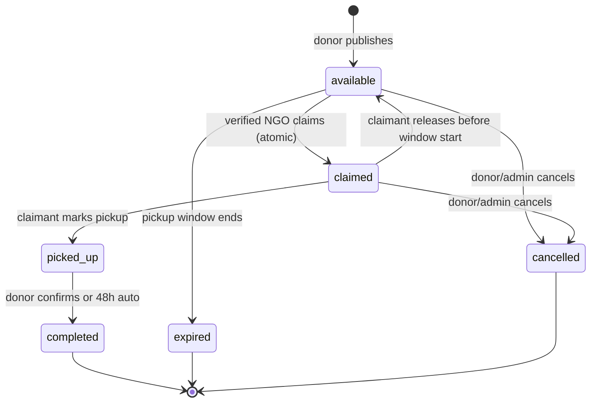

# User Flows — Food Donation Coordination System

## 1. Access matrix

| Action | Visitor | Pending/rejected org | Verified donor | Verified NGO | Admin |
| --- | --- | --- | --- | --- | --- |
| Browse available donations | Yes | Yes | Yes | Yes | Yes |
| View masked listing detail | Yes | Yes | Yes | Yes | Yes |
| Register / log in | Register | Yes | Yes | Yes | Yes |
| Upload/resubmit verification documents | No | Yes | View only | View only | Review |
| Create/manage own donations | No | No | Yes | No | No |
| Claim a donation | No | No | No | Yes | No |
| See full address/contact | No | No | Own listings | Active claim only | All |
| Mark picked up | No | No | No | Claimant only | No |
| Confirm completion | No | No | Owner, or system after 48 h | No | No |
| Verify/reject organisations | No | No | No | No | Yes |
| View all listings/claims | No | No | Own | Own claims | Yes |
| Force-cancel | No | No | Own available/claimed | No | Available/claimed |

## 2. Visitor flow

1. The visitor lands on the public listing page and sees available donations sorted by nearest pickup deadline.
2. They filter by city, area or vegetarian-only.
3. They open a listing and see the masked detail: food information, quantity, best-before, pickup window, area/city and donor display name. No street address, postcode, instructions or contact details.
4. Selecting **Claim** prompts login or registration. An unverified or non-NGO account is told what is missing and cannot claim.
5. A stale link to a donation that is now claimed, expired or cancelled shows a "no longer available" state with a link back to active listings.

## 3. Organisation registration and verification flow (donor and NGO)

1. The organisation registers with its type (`donor` or `ngo`), organisation name, contact person, phone, contact email, address, login email and password.
2. The system sends an email-verification link. The account can log in but cannot transact until the email is verified.
3. After email verification, the organisation completes its profile and uploads the required documents: typically business registration or institution authorisation plus a food-safety licence for donors, and NGO registration plus a food-safety licence for NGOs. An `other` type allows the admin to accept an equivalent document.
4. The organisation submits for review. Its status becomes `pending`; documents become `pending`; the admin queue shows the organisation.
5. The admin opens the organisation, previews each document, approves or rejects individual documents with notes, then makes a final decision:
   - **Approve:** all required documents are approved; organisation becomes `verified`; `verified_at` and `verified_by` are recorded; in-app and email notification sent.
   - **Reject:** a reason is required; organisation becomes `rejected`; the reason is shown to the owner; notification sent.
6. A rejected organisation uploads replacement documents. The new document becomes current, the old one is retained but superseded, and the organisation resubmits to `pending`.
7. While `pending` or `rejected`, the organisation can browse and manage its profile/documents but cannot create donations or claim.

Failure states: duplicate email, expired verification/reset link, invalid file type or size, missing required document, and review attempted on an organisation that is not pending.

## 4. Donor flows

### 4.1 Publish a donation

1. From the dashboard, the verified donor selects **New donation**.
2. They enter title, description, vegetarian flag, quantity and unit, best-before, pickup window start and end, pickup address, optional instructions and optional photo.
3. Client and server validate: quantity > 0; start before end; end at or before best-before; best-before in the future; allowed file type and size.
4. On publish, the donation is created as `available`, a history row is written, and the listing appears publicly with a masked address.
5. The donor sees it on their dashboard with a countdown to pickup-window end.

### 4.2 Manage an available donation

- The donor may edit content, extend the pickup end (not beyond best-before), or cancel with a reason.
- Cancelling moves the donation to `cancelled`, writes history, and removes it from public listings.
- If the pickup window ends without a claim, the scheduled job moves it to `expired` and notifies the donor. The donor may create a new listing; expired records are never reopened.

### 4.3 After a claim

1. The NGO claims; the donation becomes `claimed`; the donor is notified and sees the NGO's name and contact details.
2. Public visibility ends. The donor may no longer edit content, but may extend the pickup end with notification to the NGO.
3. When the NGO marks pickup, the donation becomes `picked_up` and the donor is notified.
4. The donor confirms completion; the donation becomes `completed` and the claim becomes `completed`. If the donor does nothing, the scheduled job completes it 48 hours after pickup confirmation.
5. The donor may cancel a claimed donation with a reason; the active claim is cancelled, the NGO is notified, and the donation is `cancelled` with no return to the public list.

### 4.4 Overdue claimed donation

If the pickup window ends while `claimed` or `picked_up`, the donation is **overdue** (derived flag, not a status). The donor sees a warning and may contact the NGO or cancel with a reason. The system never auto-expires an active commitment.

## 5. NGO flows

### 5.1 Discover and claim

1. The verified NGO browses or searches available donations and applies city/area/vegetarian filters.
2. The detail page shows masked location and donor display name, with a **Claim** button.
3. Claim is disabled with an explanation if the organisation is unverified, the email is unverified, the window has ended, or the listing is no longer available.
4. On confirmation, the server performs the atomic claim:
   - Re-check donation is `available`, pickup end is still in the future, and the NGO is verified.
   - Transition the donation to `claimed`, insert one active claim, write history, notify the donor — all in one transaction.
5. On success, the NGO sees the full address, instructions and donor contact details. This is the only point at which they are revealed.
6. On conflict (another NGO won), the NGO sees **"This donation has just been claimed"** and the refreshed listing state. If the conflict is a retry of the same NGO's successful request, the server returns the existing claim as success.

### 5.2 Release a claim

1. Allowed only before the pickup window starts and with a reason.
2. The claim becomes `cancelled`; the donation returns to `available` because the window is still open; history is written; the donor is notified.
3. Address/contact access ends immediately. The donation can be claimed by another NGO.

### 5.3 Pickup and completion

1. Before pickup-window start, **Mark picked up** is disabled.
2. After start, the NGO confirms pickup; the donation becomes `picked_up`, the claim records `pickup_confirmed_at`, and the donor is notified.
3. Late pickup is allowed with a warning that the window has ended. The donor can still cancel instead if food safety is doubtful.
4. The donor confirms completion, or the system auto-completes 48 hours after pickup confirmation. The claim becomes `completed` and both parties are notified.

### 5.4 History

The NGO sees active and past claims, outcomes and timestamps. Once a claim ends, the exact address/contact is no longer shown in history; only the area-level donation summary remains.

## 6. Admin flows

### 6.1 Verification

1. The seeded admin logs in and sees the pending-verification count.
2. They open an organisation, review its profile and each current document, and add per-document notes.
3. Final approval is possible only when every required document is approved. Final rejection requires a reason.
4. The decision, document reviews, admin identity and timestamp are recorded; the organisation is notified. Previous document versions remain stored and are never publicly accessible.
5. Rejected organisations can be re-reviewed after resubmission.

### 6.2 Oversight

1. The admin filters all donations and claims by status, city, organisation and date.
2. A detail view shows the full status history, claim history, parties and documents relevant to the case.
3. The admin may force-cancel `available` or `claimed` donations with a reason. This cancels an active claim and notifies both parties.
4. The admin cannot edit listing content, verify without documents, cancel `completed`/`expired` records, or cancel `picked_up` donations; those resolve to completed.
5. The dashboard shows pending verifications, available donations, active claims, overdue claims and completed donations.

## 7. Donation status lifecycle

| Status | Meaning | Publicly visible | Terminal |
| --- | --- | --- | --- |
| `available` | Published, unclaimed, pickup window still open | Yes, masked | No |
| `claimed` | Exactly one active claim exists | No | No |
| `picked_up` | Claimant confirmed collection; awaiting completion | No | No |
| `completed` | Handover confirmed or auto-completed | No | Yes |
| `expired` | Pickup window ended with no active claim | No | Yes |
| `cancelled` | Donor or admin cancelled | No | Yes |

**Derived state:** `overdue` = `claimed` or `picked_up` with `pickup_window_end` in the past. It is a computed warning, not an enum value.

### 7.1 Allowed transitions

| # | From | To | Actor | Condition | Side effects |
| --- | --- | --- | --- | --- | --- |
| 1 | — | `available` | Verified donor | Valid future window; end ≤ best-before | Insert donation; history |
| 2 | `available` | `claimed` | Verified NGO | Atomic win; pickup end not passed | Insert active claim; history; notify donor; reveal address |
| 3 | `available` | `expired` | System job | Pickup end passed; no active claim | History; notify donor |
| 4 | `available` | `cancelled` | Donor / admin | Reason required | History; notify relevant parties |
| 5 | `claimed` | `picked_up` | Claimant NGO | Pickup window has started | Set pickup time; history; notify donor |
| 6 | `claimed` | `available` | Claimant NGO | Before pickup-window start; reason required | Cancel claim; history; notify donor; relist |
| 7 | `claimed` | `cancelled` | Donor / admin | Reason required | Cancel claim; history; notify NGO |
| 8 | `picked_up` | `completed` | Donor / system | Donor confirms, or 48 h after pickup | Complete claim; history; notify both |

No other transitions are allowed. A claimed donation is never auto-expired, and terminal records are never reopened.

### 7.2 Lifecycle diagram

### 7.3 Claim status lifecycle

`active` on creation → `completed` when the donation completes, or `cancelled` when the NGO releases, the donor cancels, or an admin force-cancels. Pickup confirmation is a timestamp on the active claim, not a separate claim status. A donation may have several historical claims, but a partial unique index permits at most one `active` claim.

### 7.4 Automation

- **Expiry job:** every five minutes, move `available` donations with `pickup_window_end <= now()` to `expired`, write history and notify.
- **Auto-completion:** every five minutes, complete `picked_up` donations whose pickup was confirmed at least 48 hours ago.
- **Overdue detection:** a read-only query for `claimed`/`picked_up` past their window; shown on donor, NGO and admin views. No automatic status change.
- Jobs are idempotent and safe to re-run; a missed run is caught up by the next one.
- No real-time updates: pages refetch on navigation and after actions; the server is always the authority.

## 8. Edge cases

### 8.1 Two NGOs claim at the same moment

Both requests reach the server nearly simultaneously. The service performs a conditional status update and row lock in one transaction; exactly one request changes `available` to `claimed`. The winner gets the claim and the address; the loser gets HTTP 409 with `DONATION_ALREADY_CLAIMED` and no address data. A partial unique index on active claims is the database backstop if application logic regresses. The loser's UI refreshes the listing to its new state.

### 8.2 Same NGO retries a claim

If the first request succeeded but the response was lost, a retry finds the donation already `claimed` by the same NGO. The server treats this as an idempotent success: it returns the existing active claim with the same address data, creates no second claim, history row or notification. A claim by a **different** NGO remains a 409 conflict.

### 8.3 Expired food or a deadline race

- Publishing rejects a best-before in the past and any window whose end is after best-before.
- Claiming requires `now < pickup_window_end` in the same conditional update. At exactly the deadline the donation is no longer claimable.
- If the expiry job has not run yet, the failed claim still returns "no longer available"; the stale listing is corrected on the next fetch, and the job later records `expired` idempotently.
- Expired donations are terminal. A donor who still has food creates a new listing with a new id; the old record stays for history.
- A donor may extend the end before it passes, never beyond best-before. A claimed donation's NGO is notified of an extension.

### 8.4 Claimed donation becomes a no-show

- Reaching pickup-window end while `claimed` does **not** change status. It is flagged overdue.
- Donor sees a warning and may cancel with a reason; admin sees it in the overdue count and may force-cancel.
- The NGO may still mark pickup late, with a clear food-safety warning; this moves the donation to `picked_up` and then to completion.
- There is no automatic cancellation and no automatic overdue email in the MVP; the flag is visible on dashboards.

### 8.5 Rejected documents

- Only a `pending` organisation can be rejected. A rejection requires a reason; the organisation becomes `rejected` and cannot post or claim.
- Existing documents remain stored. Replacement uploads become current; old versions are retained but superseded. Resubmission sets the organisation back to `pending`.
- The owner sees the reason and document-level notes, and can replace only the failed documents.
- Revoking verification from an already-verified organisation, or periodic document renewal, is out of scope; admin force-cancel covers active listings if a verified organisation must be stopped in the MVP.

### 8.6 NGO releases a claim

- Allowed only while `now < pickup_window_start`, with a reason.
- The claim becomes `cancelled`; the donation returns to `available` (the window is necessarily still open); history is written; the donor is notified.
- Access to the exact address/contact ends immediately, and another NGO may claim.
- Release after start is blocked; the NGO must coordinate with the donor or the donor/admin cancels.

### 8.7 Donor cancels a claimed donation

- Requires a reason; the active claim becomes `cancelled`; the donation becomes `cancelled`; the NGO is notified.
- The listing does not return to the public list.
- A `picked_up` donation cannot be cancelled by anyone; it completes via donor confirmation or the 48-hour job. Disputes after pickup are out of scope.

### 8.8 Edits and extensions after a claim

- Food description, quantity, photo and pickup address are locked.
- Only the pickup-window end may be moved later, up to best-before; the NGO is notified.
- Shortening the window or moving the address requires cancelling and reposting, which the NGO sees as a cancellation.
- Reducing quantity after a claim is forbidden because it changes what the NGO committed to collect.

### 8.9 Upload and storage failures

- Files are limited to PDF/JPEG/PNG and a fixed maximum size; type is checked from content, not just the extension.
- Storage keys are random and documents live outside the public web root, served only through an authorised endpoint.
- A failed upload creates no document row and leaves the previous current document unchanged.
- Antivirus scanning is out of scope, so admin previews files in a safe viewer rather than executing them.
- Donation photos are public while the listing is available; they must not contain people or precise address details, and EXIF metadata is stripped where feasible.

### 8.10 Email delivery failure

- The business transaction commits first; the in-app notification is the durable record.
- Email is best effort; a failure is logged and never rolls back a claim, cancellation or verification.
- Verification and password-reset emails can be resent with rate limiting.
- There is no email outbox or automatic retry queue in the MVP.

### 8.11 Timezone boundaries

- All timestamps are stored and compared in UTC; the UI displays the single supported city's local time.
- Claim, expiry and pickup checks use server time, never the browser clock.
- Tests cover listings ending at midnight and around daylight-saving changes.

### 8.12 Stale pages and privacy

- Every public API projection is address-masked regardless of what the page previously displayed.
- After a claim ends, subsequent fetches hide the address/contact again; the MVP cannot erase content already cached by a browser, so the UI avoids persisting it.
- A visitor opening a stale claimed link sees an unavailable state, never the winner's pickup details.

## 9. Standard error states

| Condition | HTTP | User-facing outcome |
| --- | --- | --- |
| Not logged in / session expired | 401 | Redirect to login, return to intended page |
| Wrong role or unverified organisation | 403 | Explain what verification or role is missing |
| Donation already claimed | 409 | "Just claimed by another NGO"; refresh listing |
| Pickup window ended | 409 | "This donation has expired"; refresh |
| Pickup attempted before window start | 409 | Show the pickup start time |
| Invalid listing window or quantity | 422 | Field-level validation messages |
| Unsupported or oversized file | 422 | File requirements shown; previous document kept |
| Duplicate email | 409 | Suggest login or password reset |

## 10. Notification matrix

| Event | Recipient | In-app | Email |
| --- | --- | --- | --- |
| Organisation verified | Organisation user | Yes | Yes |
| Organisation rejected | Organisation user | Yes | Yes |
| Donation claimed | Donor | Yes | Yes |
| Claim released by NGO | Donor | Yes | Yes |
| Donation cancelled by donor | Claimant NGO | Yes | Yes |
| Donation cancelled by admin | Donor and claimant NGO | Yes | Yes |
| Pickup confirmed | Donor | Yes | Yes |
| Donation completed | Donor and claimant NGO | Yes | Yes |
| Donation expired | Donor | Yes | Yes |
| Email verification / password reset | User | — | Transactional only |

Admin verification work is driven by the dashboard queue rather than notification rows. Every in-app notification carries the related donation or claim where applicable.

## 11. API projection rules implied by these flows

- **Public listing:** masked location, no street address, postcode, instructions or contact details.
- **Donor view:** full details for their own donations.
- **Claimant view:** full pickup details only while the claim is `active`.
- **Admin view:** full details for oversight, with access logged by normal request logging.
- **History view:** area-level summary after a claim ends; exact address only for the donor's own record and the admin.
